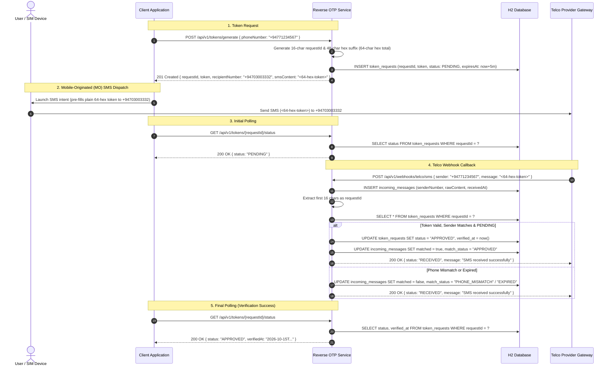

# Reverse OTP Verification Service

A Spring Boot service providing **Reverse OTP (Mobile-Originated SMS)** verification, designed for deployment on **Google Cloud Run**.

---

## 🚀 How It Works

1. **Client / App requests a token:**
   Client provides a phone number. The service generates a 64-character uppercase **pure hex** token where the **first 16 characters are the unique Request ID**, and stores it in the `token_requests` table with `PENDING` status.
2. **User sends SMS:**
   The user or app sends an SMS containing the token to the Telco shortcode.
3. **Telco calls Webhook:**
   The telco webhook forwards the SMS content and sender's phone number. The service:
   - Stores the raw message in `incoming_messages`.
   - Extracts the first 16 characters as the Request ID.
   - Matches against pending token requests for the same phone number.
   - If matched, marks as `APPROVED` with audit fields (`verified_at`, `incoming_message_id`).
   - Immediately returns a standard receipt acknowledgment to the telco (`{"status": "RECEIVED"}`).
4. **Client polls status:**
   Client queries status with the Request ID to confirm approval.



---

## 🛠 Tech Stack

- **Java 21**
- **Spring Boot 3.3.4** (Web, Data JPA, Validation, Actuator)
- **H2 In-Memory Database** (Profile: `dev`)
- **Agent-Friendly Markdown & HTML API Documentation** (`/docs.md`, `/docs`)
- **Docker** (Multi-stage build for Google Cloud Run)

---

## 📡 API Reference

### 1. Generate Token
- **Endpoint:** `POST /api/v1/tokens/generate`
- **Request Body:**
  ```json
  {
    "phoneNumber": "+94771234567"
  }
  ```
- **Response (201 Created):**
  ```json
  {
    "requestId": "4A1F8C9E2B0D7E3A",
    "token": "4A1F8C9E2B0D7E3A9F5C1B8E3D7A2F0E6D9C5B1A8E4F2D0B7A9E5C3D1F8A6B2C",
    "phoneNumber": "+94771234567",
    "recipientNumber": "+94703003332",
    "smsContent": "4A1F8C9E2B0D7E3A9F5C1B8E3D7A2F0E6D9C5B1A8E4F2D0B7A9E5C3D1F8A6B2C",
    "expiresAt": "2026-10-15T15:15:00Z"
  }
  ```

### 2. Telco MO SMS Webhook
- **Endpoint:** `POST /api/v1/webhooks/telco/sms`
- **Request Body:**
  ```json
  {
    "sender": "+94771234567",
    "message": "4A1F8C9E2B0D7E3A9F5C1B8E3D7A2F0E6D9C5B1A8E4F2D0B7A9E5C3D1F8A6B2C"
  }
  ```
- **Response (200 OK):**
  ```json
  {
    "status": "RECEIVED",
    "message": "SMS received successfully"
  }
  ```

### 3. Check Token Status
- **Endpoint:** `GET /api/v1/tokens/{requestId}/status`
- **Response (200 OK):**
  ```json
  {
    "requestId": "4A1F8C9E2B0D7E3A",
    "phoneNumber": "+94771234567",
    "status": "APPROVED",
    "createdAt": "2026-10-15T15:10:00Z",
    "expiresAt": "2026-10-15T15:15:00Z",
    "verifiedAt": "2026-10-15T15:11:30Z"
  }
  ```

---

## 🗄 Database Tables (In-Memory H2)

### `token_requests`
- `request_id` (PK, 16 hex chars)
- `phone_number`
- `token` (64 hex chars, < 160 chars)
- `status` (`PENDING`, `APPROVED`, `EXPIRED`)
- `expires_at`
- `created_at`
- `verified_at` (audit timestamp)
- `incoming_message_id` (audit foreign reference)

### `incoming_messages`
- `id` (PK, auto-increment)
- `sender_number`
- `raw_content`
- `extracted_request_id`
- `matched` (boolean)
- `match_status` (`APPROVED`, `TOKEN_NOT_FOUND`, `EXPIRED`, `PHONE_MISMATCH`, `ALREADY_APPROVED`)
- `received_at`

---

## 🏃 Running Locally

```bash
# Run application
mvn spring-boot:run

# Swagger UI:
# http://localhost:8080/swagger-ui.html

# H2 Console:
# http://localhost:8080/h2-console
# JDBC URL: jdbc:h2:mem:reverse_otp_db
# Username: sa
# Password: (empty)
```

---

## ☁️ Deploying to Google Cloud Run

```bash
# Build and deploy directly using Google Cloud Build & Cloud Run
gcloud run deploy reverse-otp-service \
  --source . \
  --platform managed \
  --region us-central1 \
  --allow-unauthenticated \
  --min-instances 1 \
  --max-instances 1
```

> **Note on H2 in Cloud Run:** When using in-memory H2, set `--min-instances 1` and `--max-instances 1` to ensure state is maintained within a single active container instance.
