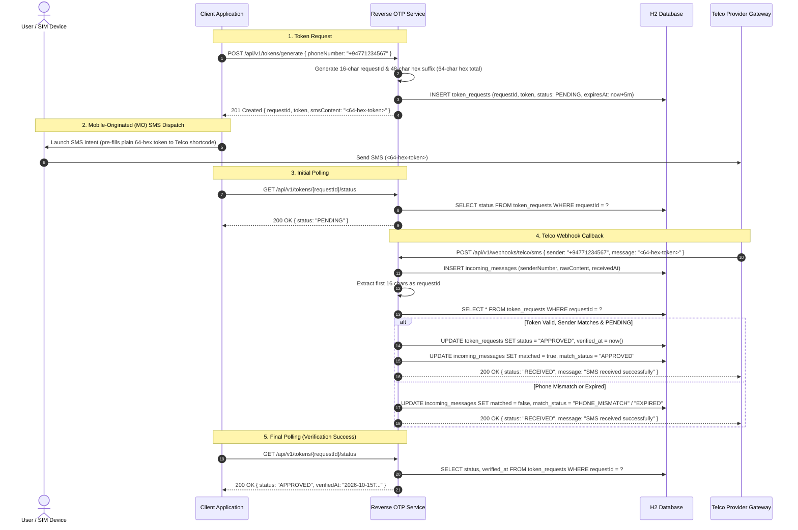

# Reverse OTP Verification Service - API Specification

> **Target Audience:** AI Agents, Developers, Automated Clients, and Telco Integrators  
> **Service Version:** 1.0.0  
> **Base URL:** `http://localhost:8080` (or Cloud Run service URL)  
> **Content-Type:** `application/json`  
> **Authentication:** None (Open for development profile)

---

## 1. Overview & Protocol Workflow

This service implements **Reverse OTP (Mobile-Originated / MO SMS)** phone number verification:



---

## 2. Token Format Specification
* **Total Length:** 64 uppercase pure hexadecimal characters (`[0-9A-F]`).
* **Request ID (First 16 chars):** Characters 0 to 15 represent the unique `requestId`.
* **Token Suffix (Remaining 48 chars):** Cryptographically secure hex payload.
* **Extraction Rule:** The service extracts `message.substring(0, 16)` to identify the request.
* **SMS Compatibility:** 64 characters easily fits in standard 7-bit GSM SMS (limit 160 chars).
* **Default TTL:** 5 minutes (Configurable via `app.token.ttl-minutes` or `app.token.ttl-seconds`).

---

## 3. Endpoints Specification

### 3.1 Generate Token
Generates a 64-char token and registers a pending verification request.

* **Method:** `POST`
* **Path:** `/api/v1/tokens/generate`
* **Headers:** `Content-Type: application/json`

#### Request Body
```json
{
  "phoneNumber": "+94771234567"
}
```
| Field | Type | Required | Description |
| :--- | :--- | :--- | :--- |
| `phoneNumber` | String | Yes | Mobile number in E.164 or national format (7 to 15 digits) |

#### Response (201 Created)
```json
{
  "requestId": "40661646BA0DE70E",
  "token": "40661646BA0DE70E3E8DD12992E7D1580D898767669A9583DAB6096B93F0FC92",
  "phoneNumber": "+94771234567",
  "smsContent": "40661646BA0DE70E3E8DD12992E7D1580D898767669A9583DAB6096B93F0FC92",
  "expiresAt": "2026-10-15T09:47:53.912Z"
}
```

---

### 3.2 Telco MO SMS Webhook
Called by telco SMS gateway upon receiving an incoming MO SMS.

* **Method:** `POST`
* **Path:** `/api/v1/webhooks/telco/sms`
* **Headers:** `Content-Type: application/json`

#### Request Body
```json
{
  "sender": "+94771234567",
  "message": "40661646BA0DE70E3E8DD12992E7D1580D898767669A9583DAB6096B93F0FC92"
}
```
| Field | Type | Required | Accepted Aliases | Description |
| :--- | :--- | :--- | :--- | :--- |
| `sender` | String | Yes | `from`, `senderNumber`, `msisdn`, `mobile` | Sender's phone number |
| `message` | String | Yes | `content`, `text`, `body`, `sms` | Raw SMS content |

#### Processing Behavior
1. Stores raw message in `incoming_messages` table.
2. Extracts first 16 characters as `requestId`.
3. Checks `token_requests` table for matching `requestId` and normalized `phoneNumber`.
4. If match is found, not expired, and `PENDING`: updates status to `APPROVED`, records `verifiedAt` and `incomingMessageId`.
5. Returns a standard HTTP 200 acknowledgment without exposing internal matching status.

#### Response (200 OK)
```json
{
  "status": "RECEIVED",
  "message": "SMS received successfully"
}
```

---

### 3.3 Get Token Verification Status
Polls current verification status for a token request.

* **Method:** `GET`
* **Path:** `/api/v1/tokens/{requestId}/status`
* **Path Parameter:**
  * `requestId` (String, 16 hex chars) - The request ID obtained from step 3.1.

#### Response (200 OK)
```json
{
  "requestId": "40661646BA0DE70E",
  "phoneNumber": "+94771234567",
  "status": "APPROVED",
  "createdAt": "2026-10-15T09:42:53.912Z",
  "expiresAt": "2026-10-15T09:47:53.912Z",
  "verifiedAt": "2026-10-15T09:43:04.245Z"
}
```

#### Status Lifecycle Values
| Status | Meaning |
| :--- | :--- |
| `PENDING` | Token generated, awaiting matching SMS from telco. |
| `APPROVED` | Valid SMS received from matching phone number, token verified. |
| `EXPIRED` | Time-to-live expired before a valid SMS was received. |

#### Response (404 Not Found)
When `requestId` does not exist:
```json
{
  "timestamp": "2026-10-15T09:45:00.000Z",
  "status": 404,
  "error": "Not Found",
  "message": "Token request not found with ID: INVALID_ID"
}
```

---

## 4. Health Check
* **Path:** `GET /actuator/health`
* **Response (200 OK):**
```json
{
  "status": "UP"
}
```

---

## 5. Machine Integration Example (cURL)

```bash
# 1. Generate Token
TOKEN_JSON=$(curl -s -X POST http://localhost:8080/api/v1/tokens/generate \
  -H "Content-Type: application/json" \
  -d '{"phoneNumber": "+94771234567"}')

REQ_ID=$(echo $TOKEN_JSON | grep -o '"requestId":"[^"]*' | cut -d'"' -f4)
TOKEN=$(echo $TOKEN_JSON | grep -o '"token":"[^"]*' | cut -d'"' -f4)

# 2. Check Status
curl -s http://localhost:8080/api/v1/tokens/$REQ_ID/status

# 3. Simulate Telco Webhook
curl -s -X POST http://localhost:8080/api/v1/webhooks/telco/sms \
  -H "Content-Type: application/json" \
  -d "{\"sender\": \"+94771234567\", \"message\": \"$TOKEN\"}"

# 4. Check Status (Now APPROVED)
curl -s http://localhost:8080/api/v1/tokens/$REQ_ID/status
```
